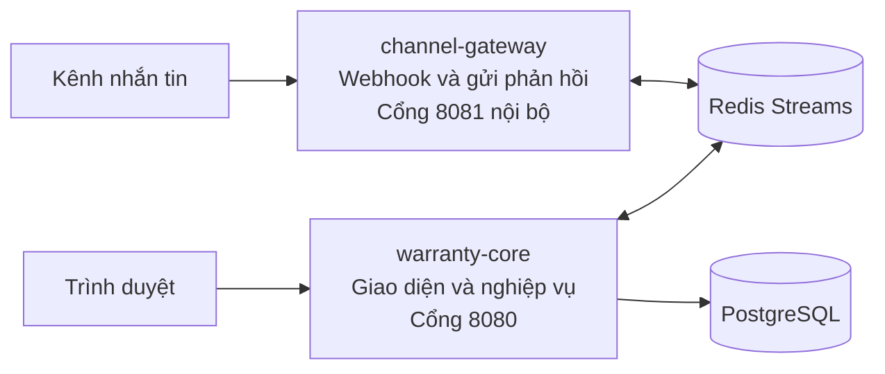

# HauMai Care

HauMai Care là hệ thống tiếp nhận và quản lý yêu cầu hậu mãi, bảo hành từ các kênh nhắn tin. Nhân viên CSKH tiếp nhận và xác minh hồ sơ; điều phối viên phân công kỹ thuật viên và theo dõi SLA; kỹ thuật viên tiếp nhận và hoàn tất sửa chữa.

## Chức năng chính

- Khách hàng tra cứu bảo hành bằng serial và tra cứu tiến độ hồ sơ bằng mã hồ sơ cùng số điện thoại.
- CSKH quản lý hội thoại, tạo và cập nhật hồ sơ, xác minh thông tin bảo hành, phản hồi khách hàng và đóng hồ sơ.
- Điều phối viên xem hàng đợi, phân công hoặc đổi kỹ thuật viên và theo dõi các mốc SLA.
- Kỹ thuật viên xem việc được giao, tiếp nhận phân công và ghi nhận hoàn tất sửa chữa.
- Tiếp nhận và phản hồi tin nhắn qua các kênh được cấu hình. Zalo có trang mô phỏng phục vụ demo.

## Kiến trúc



Trong `warranty-core`, mã nguồn được tổ chức theo ba tầng: Controller, Service và Repository. Ứng dụng `channel-gateway` tiếp nhận webhook và gửi phản hồi; hai ứng dụng trao đổi thông điệp qua Redis Streams. Chỉ `warranty-core` kết nối PostgreSQL. Lược đồ được cập nhật bằng Flyway migrations.

## Công nghệ

- Java 21, Spring Boot 3.4.5, Maven
- PostgreSQL 16, Flyway
- Redis 7 Streams
- Docker và Docker Compose
- Thymeleaf, Spring MVC và Spring Security

## Yêu cầu

- Docker Desktop đang chạy với Linux containers.
- Git để tải mã nguồn.
- Các cổng máy chủ `5433`, `6379`, `8080` và `8081` chưa được ứng dụng khác sử dụng.

## Chạy bằng Docker Compose

1. Tải mã nguồn và vào thư mục dự án:

   ```powershell
   git clone https://github.com/phuc3333/CongHauMaiVaBaoHanhDaKenh.git
   cd CongHauMaiVaBaoHanhDaKenh
   ```

2. Tạo file `.env` từ mẫu:

   ```powershell
   Copy-Item .env.example .env
   ```

   Mở `.env`, thay giá trị bắt đầu bằng `replace-with-` bằng các mật khẩu/chuỗi bí mật riêng cho máy local. Không commit hoặc gửi `.env` lên GitHub. Các biến Facebook và Zalo OA thật chỉ cần cấu hình nếu kết nối tài khoản kênh thật.

3. Khởi động các dịch vụ:

   ```powershell
   docker compose up -d --build
   docker compose ps
   ```

   Đợi PostgreSQL, Redis, `warranty-core` và `channel-gateway` chuyển sang trạng thái đang chạy. Khi tạo CSDL mới, Docker khởi tạo các vai trò cần thiết trước; sau đó `warranty-core` áp dụng migration Flyway khi khởi động.

   Các mật khẩu trong `.env` được áp dụng khi PostgreSQL tạo volume dữ liệu lần đầu. Nếu volume đã được tạo từ trước, đổi mật khẩu trong `.env` không tự đổi mật khẩu đã lưu trong PostgreSQL.

4. Mở hệ thống:

   | Nội dung | Địa chỉ |
   |---|---|
   | Trang chính | <http://localhost:8080> |
   | Đăng nhập nhân viên | <http://localhost:8080/login> |
   | Kiểm tra bảo hành | <http://localhost:8080/khach/kiem-tra-bao-hanh> |
   | Tra cứu hồ sơ | <http://localhost:8080/khach/tra-cuu> |
   | Zalo mô phỏng | <http://localhost:8081/zalo-demo.html> |

   Tài khoản demo được tạo bởi các migration seed. Các tên đăng nhập mẫu gồm `cskh`, `quanly`, `ktv01`, `ktv02` và `ktv03`. Mật khẩu được lưu dưới dạng băm trong cơ sở dữ liệu; dùng thông tin đăng nhập demo được cấp cho môi trường của bạn.

## Demo Zalo

Trang Zalo mô phỏng chạy tại `http://localhost:8081/zalo-demo.html`. Nhập số điện thoại demo và gửi tin nhắn đầu tiên theo định dạng:

```text
Họ tên: Nguyễn Minh Anh
Serial: HM-RO-2026-007
Mô tả lỗi: Máy lọc nước bị rò nước
```

Để gửi tin tiếp theo của cùng khách, giữ nguyên số điện thoại và gửi nội dung trao đổi. Luồng mô phỏng không cần tài khoản Zalo OA thật. Để nhận/gửi tin với kênh thật, cần cấu hình thông tin xác thực và endpoint webhook phù hợp của nền tảng.

## Quản lý dịch vụ

Xem trạng thái dịch vụ:

```powershell
docker compose ps
```

Xem log:

```powershell
docker compose logs -f warranty-core
docker compose logs -f channel-gateway
```

Dừng các dịch vụ nhưng giữ dữ liệu:

```powershell
docker compose down
```

Dữ liệu PostgreSQL và Redis được lưu trong Docker volumes. Không thêm `-v` vào lệnh `docker compose down` nếu muốn giữ dữ liệu.

## Cấu trúc thư mục

```text
channel-contract/  Cấu trúc thông điệp dùng chung
channel-gateway/   Webhook và tích hợp kênh
database/init/     Khởi tạo các vai trò PostgreSQL cho CSDL mới
warranty-core/     Giao diện, nghiệp vụ, repository và Flyway migrations
docker-compose.yml Cấu hình chạy các dịch vụ
```

## Ghi chú

- Docker build hiện đóng gói ứng dụng với `-DskipTests`; lệnh chạy hệ thống không đồng nghĩa với việc các nghiệp vụ đã được kiểm thử tự động.
- Không đưa mật khẩu, token của Facebook/Zalo hoặc file `.env` lên repository.
